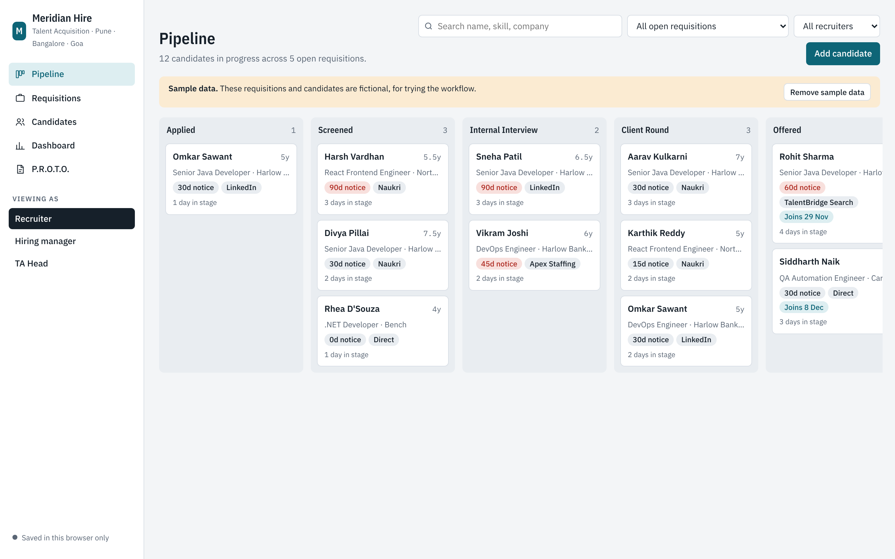
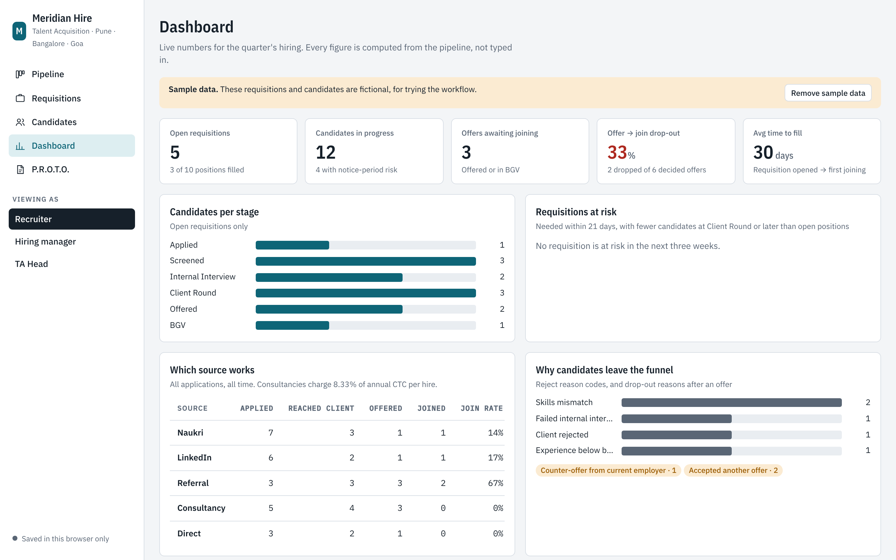
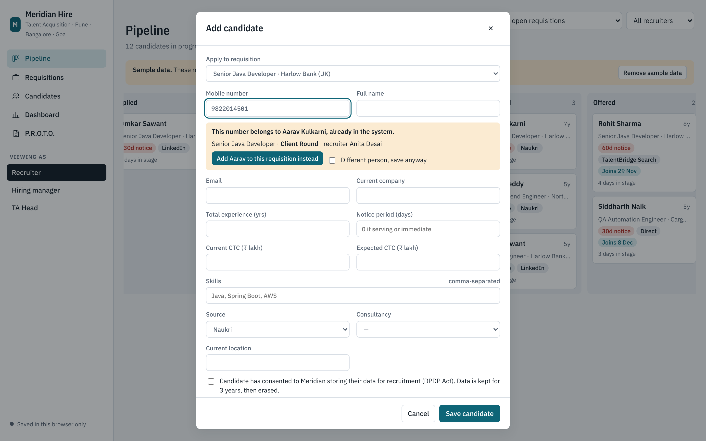

# Meridian Hire — Applicant Tracking System

An applicant tracking system for **Meridian Technologies Pvt. Ltd.**, a 450-person Indian IT services company (Pune, Bangalore, Goa) hiring 60 people a quarter for US and UK client projects. It replaces four out-of-sync Excel trackers with one pipeline.

Built with the **P.R.O.T.O.** framework (Problem → Research → Owners → Tasks → One slice). All five artifacts are inside the app under the **P.R.O.T.O.** tab.

## The problem

Four recruiters keep four copies of one Excel tracker. Last month two of them called the same candidate on the same day for two different roles, and she posted about it on LinkedIn. A client's status question about a Java position took a day and a half to answer. With 60 hires this quarter and 20% attrition, the TA Head suspects a third of accepted offers never join, and nobody can prove it.

**Core loop:** a recruiter can take one candidate from Applied to Joined, against a client requisition, without opening Excel, and nobody else on the team calls that candidate by mistake.

## What it does

| Area | Feature |
|---|---|
| Requisitions | Title, client, project, project/bench type, skills, experience band, CTC range, location, positions, billing rate (USD/hr), needed-by date, target closure, max notice period, recruiter, hiring manager |
| Candidates | Name, phone, email, current company, current and expected CTC, notice period, experience, skills, source (Naukri / LinkedIn / Referral / Consultancy / Direct), consultancy name, DPDP consent |
| Applications | One candidate can apply to several requisitions; each application has its own stage and history |
| Pipeline | Applied → Screened → Internal Interview → Client Round → Offered → BGV → Joined, plus Rejected and Dropped Out at any point |
| Stage moves | Forward or backward, timestamped with who moved it; reject and drop-out need a reason code; an offer needs offered CTC and joining date |
| Duplicate check | Typing a phone number that exists shows the person, their applications and recruiters, and offers to add them to your job instead |
| Notice-period risk | Cards are flagged red when today + notice falls after the project's needed-by date, or above the requisition's notice cap |
| Notes | Free text with author and timestamp |
| Client status | One button copies a status update for the client, ready to paste into email |
| Dashboard | Open requisitions, candidates per stage, offer → join drop-out, average time to fill, requisitions at risk, source effectiveness, reject and drop reasons |
| Role views | Recruiter, Hiring manager (no salary, consultancy or rejected candidates; Internal Interview onward only), TA Head |
| DPDP | Consent required to save; retention date shown; one-click erasure of a candidate's data |

| Dashboard | Duplicate warning |
|---|---|
|  |  |

## Definitions

- **Time to fill:** requisition opened → first candidate joined.
- **Offer → join drop-out:** dropped ÷ (joined + dropped), over applications that reached Offered and have an outcome.

## Scope (MoSCoW)

- **Must (built):** requisitions, candidates, applications, stages, timestamped moves, duplicate warning, notes, source tracking.
- **Should (built):** skill search and filters, recruiter per requisition, offer details, dashboard, reject reason codes. **Next:** resume upload, interview scheduling, email from the app.
- **Could:** candidate portal, email templates, consultancy commission, client report, bulk import, offer-drop risk flag, audit log, job-board integration, mobile HM view.
- **Won't (v1):** payroll, onboarding, performance management, anything AI-powered.

## Running it

It is a single static page with no build step and no backend.

- Open `index.html` in a browser, or deploy the repository to any static host (Vercel, GitHub Pages, Netlify).
- Data is saved in the browser's local storage, and the app starts with clearly marked fictional sample data. Use **Remove sample data** to start clean.
- `app.html` is the source; `./build.sh` wraps it into `index.html`.

## Known limits of this prototype

- In the static deployment, each browser keeps its own data. A shared database is the next step before recruiters use it for real.
- Role views change what is shown; they are not access control. Real use needs sign-in and server-side permissions.

## What broke and how I fixed it

_To be written by the author (P.R.O.T.O. submission checklist)._
